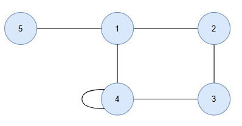
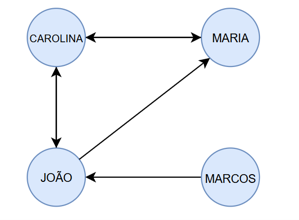
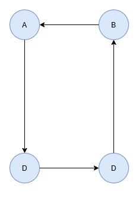
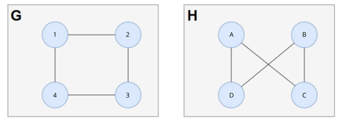

# Material do Estudante – Prática de Grafos

**Disciplina:** Estrutura de Dados II | **Unidade III:** Grafos  
**Professora:** Kadidja Valéria  
**Aluna:** Isaú Júlio de Resende Viana dos Santos 

---

## 1. Atividade 1 – Desenhando um grafo

Considerando $V = \{1, 2, 3, 4, 5\}$ e $E = \\{(1,2), (1,4), (1,5), (2,3), (3,4), (4,4)\\}$:

- **Ordem:** 5  
- **Tamanho:** 6  
- **Laço:** $(4,4)$ *(contado duas vezes no cálculo do grau)*  
- **Graus:** $v_1 = 3$, $v_2 = 2$, $v_3 = 2$, $v_4 = 4$, $v_5 = 1$

---

## 2. Atividade 2 – Incidência e adjacência

### 1. Vértices Adjacentes
- **Vértice 1:** 2, 4 e 5.
- **Vértice 2:** 1 e 3.
- **Vértice 3:** 2 e 4.
- **Vértice 4:** 1, 3 e ele mesmo (4) (devido ao laço).
- **Vértice 5:** 1.

### 2. Arestas Incidentes
- **Vértice 1:** $(1,2)$, $(1,4)$, $(1,5)$.
- **Vértice 2:** $(1,2)$, $(2,3)$.
- **Vértice 3:** $(2,3)$, $(3,4)$.
- **Vértice 4:** $(1,4)$, $(3,4)$, $(4,4)$.
- **Vértice 5:** $(1,5)$.

### 3. Justificativa de Adjacência
- **Adjacentes (1 e 2):** Conectados diretamente pela aresta $(1,2)$.
- **Não adjacentes (2 e 5):** Não há nenhuma aresta que os conecte diretamente.

---

## 3. Atividade 3 – Modelagem de uma rede de amizades

Considerando o grupo (João, Carolina, Maria, Marcos):

### 1. Definições
- $V = \\{\text{CAROLINA, MARIA, JOÃO, MARCOS}\\}$
- $E = \\{(\text{CAROLINA, MARIA}), (\text{MARIA, CAROLINA}), (\text{CAROLINA, JOÃO}), (\text{JOÃO, CAROLINA}), (\text{JOÃO, MARIA}), (\text{MARCOS, JOÃO}\\}$
- **Tipo:** Grafo Dirigido (as conexões expressam vias de mão única ou mútua, como seguir no Instagram).

### 2. Maior Grau
Calculado por $\text{Grau Total} = \text{Entrada} + \text{Saída}$:
- **CAROLINA:** $2 + 2 = 4$
- **JOÃO:** $2 + 2 = 4$
> **Maior Grau:** Carolina e João ($\text{grau} = 4$).

---

## 4. Atividade 4 – Modelagem de ruas de mão única

### 1. Definições
- $V = \\{A, B, C, D\\}$
- $E = \\{(A,D), (D,C), (C,B), (B,A)\\}$

### 2. Grau do Vértice A
- **Entrada:** $1$ (vem de $B$) | **Saída:** $1$ (vai para $D$) | **Total:** $2$

### 3. Justificativa
O grafo não dirigido implicaria mão dupla em todas as vias. O grafo dirigido é indispensável para indicar o sentido correto do trânsito.

---

## 5. Atividade 5 – Desafio de Isomorfismo

Comparando $G$ e $H$:
- **Ordem e Tamanho:** $|V(G)| = |V(H)| = 4$ e $|E(G)| = |E(H)| = 4$.
- **Graus:** Todos os vértices de ambos os grafos possuem grau $2$.

### 1. Mapeamento ($f: V(G) \to V(H)$)
| Vértice em G | Correspondente em H |
| :---: | :---: |
| 1 | a |
| 2 | c |
| 3 | b |
| 4 | d |

> Todas as adjacências de $G$ são rigorosamente preservadas em $H$ (ex: $(1,2) \to (a,c)$).

### 2. Conclusão
Os grafos **$G$ e $H$ são isomorfos** por manterem a mesma estrutura cíclica, ordens, tamanhos, graus e preservação bijetora de adjacências.